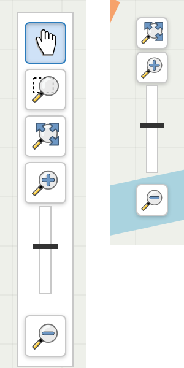

# QGIS icons in the map navigation bar

## Purpose

Replace the icons of the map navigation bar with the QGIS desktop icons, so users find
the same tools as in QGIS: pan, zoom to area, zoom to full extent, zoom in, zoom out,
previous and next extent. The zoom slider is kept.

* White buttons with a grey border, the active tool (pan or zoom to area) is highlighted in blue.
* On small screens (width ≤ 768 px), the bar is compacted and the tools that are not
  convenient with a finger (pan, zoom to area, previous/next extent) are hidden.
* The SVG icons are embedded in the JavaScript file (data URIs), there is nothing else to upload.

## Notes

Since LWC 3.6, the navigation bar is the `<lizmap-navbar>` web component, which rewrites the
`class` attribute of the buttons on each state change. A custom class added by a script is
therefore lost: the CSS of this script only relies on Lizmap's own classes (`button.btn`,
`.active`), with a higher specificity than `map.css` (`#navbar#navbar button.btn.btn`).

## Configuration

At the top of the file:

| Constant            | Default | Description                                       |
|---------------------|---------|---------------------------------------------------|
| `ICON_SIZE`         | `22`    | Icon size in pixels                               |
| `HIDE_SLIDER`       | `false` | Hide the zoom slider                              |
| `MOBILE_BREAKPOINT` | `768`   | Screen width under which the bar is compacted     |
| `MOBILE_ICON_SIZE`  | `18`    | Icon size on small screens                        |
| `MOBILE_HIDE`       | …       | Selectors of the tools hidden on small screens    |

## Icons license

The icons come from the [QGIS default theme](https://github.com/qgis/QGIS/tree/master/images/themes/default)
(© QGIS contributors, GNU GPL v2 or later).

## Compatibility

Tested with Lizmap Web Client 3.6.12.
